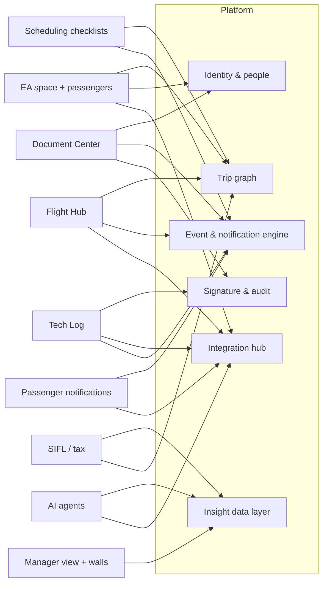

# myGFO — Roadmap

- **Status:** Draft 1 for discussion — 2026-10-22
- **Companion:** [`MANIFESTO.md`](./MANIFESTO.md) — the principles and the "golden thread" this roadmap delivers.
- **Rule for this file:** horizons are **gated, not dated**. A horizon starts when its gates clear, not when a calendar says so. Dates go in only once team capacity is known (Open Question A).

---

## 1. Where we actually are

The honest picture, because the roadmap has to start from it.

**The prototype is broad.** This repository holds a working, mock-data prototype of far more than Document Center and Tech Log: scheduling workspace and boards, an EA booking flow with messages, passenger records and forms, a 72-hour passenger email, Flight Hub, airport company pages, inventory and commissary, safety (FRAT/GRAT/ASAP/hazards), a lead dashboard, critical business functions, rolling action items, wall-screen views, a global notification feed, and a SIFL/tax screen.

**Production is narrow.** Nothing is in production yet. Everything above runs on mock data, in-memory stores or `localStorage`. The prototype stack (Vite, Hono, Neon Postgres, Vercel) is also **not** the production stack in `CLAUDE.md` (Azure, Entra, Azure SQL ledger tables, Capacitor on iPad, Key Vault).

That gap is the single biggest fact on this roadmap. The vision is a vision of **connection**, and connection only exists once real data flows between real systems. Every horizon below therefore pairs new capability with moving something from prototype to production.

| Area | Prototype | Production | Notes |
|---|---|---|---|
| Document Center | Deep | — | Bulletins that amend a manual, absorption inbox, suggestions to owner, read-and-initial that re-arms per revision, review cycles, register. Group drives / SharePoint reconciliation is a draft design. ForeFlight Documents mirroring not built. |
| Tech Log | Deep | — | 9 phases with engine tests. Blocked on CAMP utilization-push (OQ1), myairops OData (OQ2), DOM rulings. |
| Scheduling + checklists | Deep | — | Rules engine with due rules, conditions, ack-escalation, versioned templates. Real Postgres adapter exists but boards run on mock. |
| EA booking + messages | Medium | — | Request builder, approvals queue, watches, messages both ways. Write-back to myairops blocked (OQ5). |
| Passenger records | Medium | — | PII residency undecided (OQ6). Default: read-through, mirror nothing. |
| Flight Hub (crew) | Medium | — | Pilot readiness, trip brief, acceptance, preflight. FA side is separate screens. No persistence contract. |
| Airport company pages | Medium | — | Pilot/maintenance lens, evaluator worklist, rules and flags. |
| ForeFlight Files (trip sheets, pax docs) | Medium | — | Client + flight matcher + trip-sheet document. |
| Notifications / accountability | Medium | — | Derived feed design implemented; escalation exists only inside scheduling. No manager escalation ladder app-wide. |
| Manager views | Shallow | — | Screens exist; real data does not. |
| Wall screens | Shallow | — | Ops, maintenance, scheduling walls on mock data. |
| SIFL / tax | Shallow | — | Screen and context exist; not validated. |
| FlightAware, Workday, FCM, FAA feeds | — | — | Not started. Satcom has a mock service only. |
| AI agents | — | — | Not started. |

## 2. The shared platform — build once, used by everything

Every feature in the vision rests on the same six pieces. Building them per module is how the prototype got broad; building them once is how production gets connected.

1. **Identity and people.** Entra sign-in, one person record per human (crew, mechanic, EA, passenger), roles, and the manager chain. The manager chain is what makes escalation possible. Workday is the eventual source.
2. **The trip graph.** One trip, its legs, aircraft, crew and passengers, keyed to myairops. Everything else hangs off it: checklists, briefings, catering, documents, tax.
3. **The event and notification engine.** Changes become events. Events re-fire checklist items and derive notifications per audience. The **accountability ladder** lives here: ask, remind, escalate to manager. Built once, configured per domain. Quiet hours and crew rest are respected by the engine, not by each feature.
4. **The integration hub.** One adapter per outside system, behind a capability gate, with the vendor's shapes and units stopped at the boundary. CAMP and myairops first, then ForeFlight, FlightAware, Workday, Satcom, FAA.
5. **Signature and audit.** The e-signature service from `CLAUDE.md`: JCS hashing, append-only ledger, server re-stamp. Used by Tech Log, document acknowledgments, and crew acceptance.
6. **The data layer for insight.** A read-only analytical copy of the above. Managers' dashboards, wall screens, SIFL and every future AI agent read from here, never from production tables directly.

## 3. Horizons

### Horizon 0 — Land what we are building (now)

**Outcome:** Document Center and Tech Log are in production, used by real people, on the production stack.

- Stand up the production platform minimum: Entra, Azure SQL with ledger tables, Key Vault, the signature service, the notification engine core.
- **Document Center:** port the existing engine to production; build ForeFlight Documents mirroring of the pilot content pack; group-drive reconciliation (from the 2026-07-30 design, once its open questions close); read-and-sign escalation to the manager.
- **Tech Log:** production backend, offline iPad build with native SQLite, CAMP **sandbox** read path. Resolve the DOM rulings (check-flight gate, supersede authority, RII ATA list) before the ledger schema freezes, because ledger schema cannot be reverted.
- **Stop adding prototype surface** except where it de-risks a decision. Every new prototype screen widens the gap in section 1.

**Gates to exit:** both modules used on real trips for a full month; immutability, idempotency and hash tests green in CI; CAMP sandbox round-trip proven.

### Horizon 1 — The crew's day

**Outcome:** a pilot or flight attendant opens one place and sees everything about their next trip, and their iPad already has it in ForeFlight.

- **Trip graph** in production, pulled from myairops (unblocked by OQ2).
- **Flight Hub** for pilots and flight attendants on real trips: readiness, brief, acceptance, the crew-relevant checklist items.
- **Scheduling checklists** on the real engine, with **automatic re-fire** when a trip changes, notifying only the item owners.
- **ForeFlight Files:** trip sheets and passenger documents pushed automatically.
- **Airport company pages** in production, pushed to ForeFlight alongside the trip.
- **Accountability ladder** generalized app-wide: documents, checklists, status updates.

**Gates:** OQ2 answered; trip graph matches myairops on every leg for a month with no manual fix-ups.

### Horizon 2 — The EA and the passenger

**Outcome:** an EA books, manages passengers and gets answers without a phone call, and passengers get the right information at the right moment.

- **EA ↔ scheduling space** per the booking-portal phase plan, stages 1–5. Stage 6 (write-back) stays gated on OQ5.
- **Passenger records** with document currency, briefing currency, food preferences and allergies. Gated on OQ6.
- **FlightAware integration**, starting with live position and status, then Foresight predictions for taxi-out and ETA.
- **Passenger notifications** by email first: the 72-hour email (exists in prototype), the night-before brief, and day-of-travel updates such as block out, taxi estimate, airborne, and door-open estimate. Recipients are the EA and opted-in delegates by default.
- **Wall screens** on real data for each sub-department.

**Gates:** OQ6 decided; security sign-off on any message that reveals a principal's real-time position.

### Horizon 3 — The 30,000-ft view and the back office

**Outcome:** a manager sees the state of the department and its critical work without asking anyone, and the niche procedures run in-house.

- **Manager view** on the insight data layer: critical business functions, rolling action items, overdue accountability, fleet and trip health.
- **Workday bridge:** people, roles, and the manager chain sourced from Workday instead of maintained by hand.
- **SIFL and tax** computed in-house from the manifest, purpose and aircraft data. Parallel-run against the current method for a full tax year before anyone relies on it.
- **Satcom and FAA sources** for in-flight messaging and regulatory data (NOTAMs, registry, airport data), where they feed a real decision.
- **FCM** (travel management) for crew travel, if it earns its place.
- **CAMP utilization push**, once OQ1 is answered by CAMP under sandbox credentials.

**Gates:** tax counsel agrees the method; Workday access agreed with HRIS.

### Horizon 4 — Intelligence

**Outcome:** people ask questions in plain language and get answers grounded in our data and in certified aviation data, with the reasoning shown.

- **Integrate Jeppesen ForeFlight Airflow first.** Its business-aviation agents, Trip Feasibility and Ops Briefing, were announced on 16 October 2026 inside ForeFlight Dispatch, with a broader rollout planned for early 2027. That is most of the "can we do this trip, and what do we need to know" use case, built on certified data we do not have.
- **Build our own agents only for our own data.** An EA assistant that answers "who is on Tuesday's trip, are their documents current, have they been briefed" from the insight layer. It starts **read-only**. Drafting a request comes next, after a human-review step is in place. It never commits anything on its own.
- **Performance questions** such as "can the G500 depart runway 21 at LUK on a hot day with this fuel" are answered by ForeFlight or AFM-approved performance data. The agent asks and explains. It never computes takeoff performance itself.
- **Passenger app**, if the email channel proves the demand. It is a separate product with its own security review.

**Gates:** the insight data layer exists; an AI usage policy agreed with P&G IT and legal.

**AI before Horizon 4.** A read-only question-answering assistant over published documents can ship as early as Horizon 1, because the Document Center is the first production data set and the risk is low. Anything that touches trips or people waits for the insight layer.

## 4. Where the project ends — today's scope line

The current project is **done** when the golden thread in the manifesto runs end to end on a real trip, with every step on production data. That is the end of Horizon 4.

Explicitly outside the line, until decided otherwise:

- Replacing CAMP, myairops, ForeFlight or Workday.
- Writing to myairops, until OQ5 is deliberately resolved.
- Mirroring passenger PII, until OQ6 is decided.
- Any autonomous AI action that commits a booking, a release or a signature.
- Real-time passenger location sharing beyond the EA and opted-in delegates, without a security sign-off.

New ideas go into a parking lot, not into a horizon, until one of the gates above is reviewed.

## 5. Risks

| Risk | Why it matters | Mitigation |
|---|---|---|
| Prototype breadth outruns production | Every mock screen sets an expectation the production team must meet. | Horizon 0 freezes new prototype surface. |
| Notification fatigue | "Only if they need to" fails if every module adds alerts. | One engine, a per-person budget, quiet hours, and review of every new alert type. |
| Escalation reads as surveillance | Crew trust drops and people game the signals. | Escalate on the work, not the person. Make the ladder visible to the person first. |
| Vendor dependency | myairops write and CAMP utilization are undocumented or ungranted. | Gates stay hard. Pull-only until answered. |
| Tax liability | An in-house SIFL error is a real tax exposure for named people. | One full parallel year and counsel sign-off. |
| AI overreach | A confident wrong answer about performance or a manifest is a safety or privacy event. | Advisory only, certified sources, reasoning shown, human decides. |
| Key-person risk | The vision lives in one head today. | This file and the manifesto. The DEVELOPER_HANDOFF_V2 doc is a start. |

## 6. Open questions for this roadmap

These are separate from the numbered Open Questions in `CLAUDE.md`, which still govern.

- **A. Capacity.** Who builds production: you with assisted sessions, a P&G IT team, or a contractor? This sets every date.
- **B. Scheduling system of record.** Is myairops the long-term scheduling system, or is myGFO's booking engine meant to replace it eventually? The recent "the booking is the only trip" work points one way and `CLAUDE.md` points the other.
- **C. ForeFlight Dispatch.** Does GFO use or plan to use Dispatch? Airflow's business-aviation agents live there.
- **D. Passenger channel.** Email first and an app later, or an app from the start? Who in exec protection signs off?
- **E. What "40%" means for documents.** Measured against the prototype or against production? Section 1 suggests the prototype engine is further along than that, while production has not started.
- **F. Workday ownership.** Who in HRIS grants access, and is the manager chain in Workday reliable enough to escalate against?
