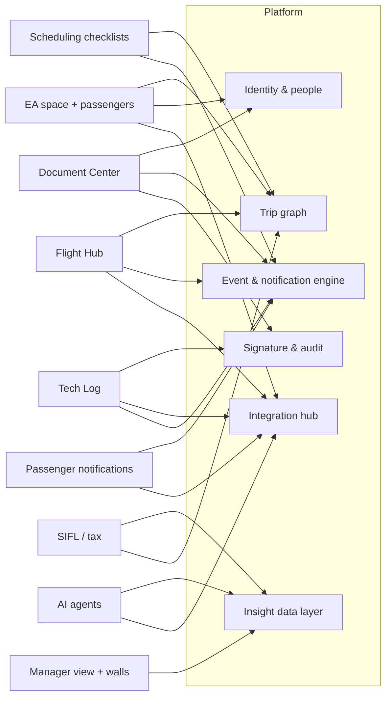

# myGFO — Roadmap

- **Status:** Draft 1 for discussion — 2026-10-22
- **Companion:** [`MANIFESTO.md`](./MANIFESTO.md) — the principles and the "golden thread" this roadmap delivers.
- **Rule for this file:** horizons are **gated, not dated**. A horizon starts when its gates clear, not when a calendar says so. Dates go in only once team capacity is known (Open Question A).

---

## 1. Where we actually are

There are three places myGFO lives, and this roadmap needs to be read with all three in mind:

1. **This repository** is a design sandbox: a working, mock-data prototype on a hobby stack (Vite, Hono, Neon, Vercel). It is useful for thinking through rules and edge cases. It is **behind** Bryan's current thinking.
2. **Bryan's work mockups** are newer, built with Copilot in the P&G design system. They are the hand-off spec to the developer. Claude cannot see them.
3. **The production platform** is built by a developer from those hand-offs, on the stack in `CLAUDE.md`. A lot of it is built already.

So the table below describes **how deeply each idea has been explored in this sandbox**, not what is live. Production status belongs in the developer's backlog. The column is left for Bryan to fill in so this file can show both.

| Area | Sandbox depth | In production? | Notes from the sandbox |
|---|---|---|---|
| Document Center | Deep | _fill in_ | Bulletins that amend a manual, absorption inbox, suggestions to owner, read-and-initial that re-arms per revision, review cycles, register. Group drives / SharePoint reconciliation is a draft design. ForeFlight Documents mirroring not built. |
| Tech Log | Deep | _fill in_ | 9 phases with engine tests. Blocked on CAMP utilization-push (OQ1) and DOM rulings. |
| Scheduling + checklists | Deep | _fill in_ | Rules engine with due rules, conditions, ack-escalation, versioned templates. |
| EA booking + messages | Medium | _fill in_ | Request builder, approvals queue, watches, messages both ways. Write-back to myairops blocked (OQ5). |
| Passenger records | Medium | _fill in_ | PII residency undecided (OQ6). Default: read-through, mirror nothing. |
| Flight Hub (crew) | Medium | _fill in_ | Pilot readiness, trip brief, acceptance, preflight. FA side is separate screens. |
| Airport company pages | Medium | No | Source labels, propose → review → publish, per-field confirmation, officer worklist, rules and flags. See [`airport-knowledge-loop.md`](./airport-knowledge-loop.md). |
| ForeFlight Files (trip sheets, pax docs) | Medium | _fill in_ | Client, flight matcher, trip-sheet document. |
| Notifications / accountability | Medium | _fill in_ | Derived feed implemented. Escalation exists only inside scheduling. |
| Manager views | Shallow | _fill in_ | Screens exist on mock data. |
| Wall screens | Shallow | _fill in_ | Ops, maintenance, scheduling walls on mock data. |
| SIFL / tax | Shallow | _fill in_ | Screen and context exist; not validated. |
| FlightAware, Workday, FCM, FAA NOTAMs | — | _fill in_ | Not explored. FAA NASR is bundled for airports. Satcom has a mock service only. |
| Airflow / AI agents | — | — | Not started. Evaluation plan in Horizon 4. |

## 2. The shared platform — build once, used by everything

Every feature in the vision rests on the same six pieces. Building them per module is how the prototype got broad; building them once is how production gets connected.

1. **Identity and people.** Entra sign-in, one person record per human (crew, mechanic, EA, passenger), roles, and the manager chain. The manager chain is what makes escalation possible. Workday is the eventual source.
2. **The trip graph.** One trip, its legs, aircraft, crew and passengers, keyed to myairops. Everything else hangs off it: checklists, briefings, catering, documents, tax.
3. **The event and notification engine.** Changes become events. Events re-fire checklist items and derive notifications per audience. The **accountability ladder** lives here: ask, remind, escalate to manager. Built once, configured per domain. Quiet hours and crew rest are respected by the engine, not by each feature.
4. **The integration hub.** One adapter per outside system, behind a capability gate, with the vendor's shapes and units stopped at the boundary. CAMP and myairops first, then ForeFlight, FlightAware, Workday, Satcom, FAA.
5. **Signature and audit.** The e-signature service from `CLAUDE.md`: JCS hashing, append-only ledger, server re-stamp. Used by Tech Log, document acknowledgments, and crew acceptance.
6. **The data layer for insight.** A read-only analytical copy of the above. Managers' dashboards, wall screens, SIFL and every future AI agent read from here, never from production tables directly.

## 3. Horizons

### Horizon 0 — Land what we are building (now)

**Outcome:** Document Center and Tech Log are in production, used by real people, on the production stack.

- Confirm the production platform minimum is in place, since much is already built: Entra, Azure SQL with ledger tables, Key Vault, the signature service, the notification engine core. Anything missing here comes first.
- **Document Center:** finish the living-document model in production; build ForeFlight Documents mirroring of the pilot content pack; group-drive reconciliation (from the 2026-07-30 design, once its open questions close); read-and-sign escalation to the manager.
- **Tech Log:** production backend, offline iPad build with native SQLite, CAMP **sandbox** read path. Resolve the DOM rulings (check-flight gate, supersede authority, RII ATA list) before the ledger schema freezes, because ledger schema cannot be reverted.
- **Mockups stay the spec, and each one names its gate.** A mockup for a feature behind an open question, such as myairops write-back, should say so on the screen. Otherwise it sets an expectation the developer cannot meet.

**Gates to exit:** both modules used on real trips for a full month; immutability, idempotency and hash tests green in CI; CAMP sandbox round-trip proven.

### Horizon 1 — The crew's day

**Outcome:** a pilot or flight attendant opens one place and sees everything about their next trip, and their iPad already has it in ForeFlight.

- **Trip graph** in production, pulled from myairops (unblocked by OQ2).
- **Flight Hub** for pilots and flight attendants on real trips: readiness, brief, acceptance, the crew-relevant checklist items.
- **Scheduling checklists** on the real engine, with **automatic re-fire** when a trip changes, notifying only the item owners.
- **ForeFlight Files:** trip sheets and passenger documents pushed automatically.
- **The airport knowledge loop, without AI:** a per-airport briefing that opens with what is new since this pilot last looked, labels every line as official, company, our history or crew-reported, and a post-trip debrief that confirms or corrects it. Required after international trips. Company pages go to ForeFlight alongside the trip. Design: [`airport-knowledge-loop.md`](./airport-knowledge-loop.md).
- **Accountability ladder** generalized app-wide: documents, checklists, status updates.

**Gates:** OQ2 answered; trip graph matches myairops on every leg for a month with no manual fix-ups.

### Horizon 2 — The EA and the passenger

**Outcome:** an EA books, manages passengers and gets answers without a phone call, and passengers get the right information at the right moment.

- **EA ↔ scheduling space** per the booking-portal phase plan, stages 1–5. Stage 6 (write-back) stays gated on OQ5.
- **Passenger records** with document currency, briefing currency, food preferences and allergies. Gated on OQ6.
- **FlightAware integration**, starting with live position and status, then Foresight predictions for taxi-out and ETA.
- **Passenger notifications by email** (decided 2026-10-22; an app only if passengers ask for one): the 72-hour email (exists in prototype), the night-before brief, and day-of-travel updates such as block out, taxi estimate, airborne, and door-open estimate. Recipients are the EA and opted-in delegates by default.
- **Wall screens** on real data for each sub-department.

**Gates:** OQ6 decided; security sign-off on any message that reveals a principal's real-time position.

### Horizon 3 — The 30,000-ft view and the back office

**Outcome:** a manager sees the state of the department and its critical work without asking anyone, and the niche procedures run in-house.

- **Manager view** on the insight data layer: critical business functions, rolling action items, overdue accountability, fleet and trip health.
- **Workday bridge:** people, roles, and the manager chain sourced from Workday instead of maintained by hand.
- **SIFL and tax** computed in-house from the manifest, purpose and aircraft data. Parallel-run against the current method for a full tax year before anyone relies on it.
- **Satcom and FAA sources** for in-flight messaging and regulatory data (NOTAMs, registry, airport data), where they feed a real decision.
- **FCM** (travel management) for crew travel, if it earns its place.
- **CAMP utilization push**, once OQ1 is answered by CAMP under sandbox credentials.

**Gates:** tax counsel agrees the method; Workday access agreed with HRIS.

### Horizon 4 — Intelligence

**Outcome:** people ask questions in plain language and get answers grounded in our data and in certified aviation data, with the reasoning shown.

- **Integrate Jeppesen ForeFlight Airflow first, if the evaluation below says it fits.** GFO already uses ForeFlight Dispatch, and Airflow's business-aviation agents, Trip Feasibility and Ops Briefing, were announced on 16 October 2026 inside Dispatch, with a broader rollout planned for early 2027. That covers most of the "can we do this trip, and what do we need to know" use case, built on certified data we do not have.
- **Build our own agents only for our own data.** An EA assistant that answers "who is on Tuesday's trip, are their documents current, have they been briefed" from the insight layer. It starts **read-only**. Drafting a request comes next, after a human-review step is in place. It never commits anything on its own.
- **Performance questions** such as "can the G500 depart runway 21 at LUK on a hot day with this fuel" are answered by ForeFlight or AFM-approved performance data. The agent asks and explains. It never computes takeoff performance itself.
- **Passenger app**, only if passengers ask for it after the email channel is running. It is a separate product with its own security review.

#### Airflow evaluation — before anything is built

Airflow is the bet that keeps crews in two apps instead of three or four, so the evaluation deserves its own plan. The steps are Bryan's: see the demos, talk to their teams, write use cases, then take a recommendation to the VP.

**Candidate use cases**, in the order they would be piloted:

1. **Ops briefing that includes our airport knowledge.** Official worldwide data from Airflow, plus our company pages and recent crew reports, in one ForeFlight briefing. This is the airport knowledge loop's step 2.
2. **Trip feasibility for scheduling.** "Can a G500 do KLUK–EGGW on Thursday with five passengers?" Customs, fire category, parking, noise, fuel and runway checks, answered before scheduling commits.
3. **Feasibility as an input to the EA's request.** The EA asks, the answer comes back with feasibility and cost, and the request is pre-filled. This needs use case 2 working first.
4. **Disruption options.** When a tail goes down in the Tech Log, rank the recovery options. Today this agent is airline-only, so check whether a business-aviation version is planned.

**Questions for the demos:**

1. Can Ops Briefing or Trip Feasibility take **operator content** as input: company pages, airport notes, our own crew reports? Through which API?
2. Can our system **call the agents** and get structured results back, or do they live only inside the Dispatch UI?
3. What is the **automation tier** for each agent, from advisory only to autonomous? We want advisory only.
4. How is the **reasoning shown**, and can we keep it as a record with the trip?
5. Does takeoff performance come from **approved AFM data** for the G500, G650ER and, later, the G800?
6. Where is our data **processed and stored**? Is it used to train models? What does P&G IT security need to see?
7. What does the **ForeFlight AI Connector**, their MCP server, expose, and does it support Claude yet?
8. What is the **pricing model**, and what is the timeline for business-aviation rollout?

**What the VP pitch needs:** one use case shown end to end on a real past trip, the time it saves scheduling or crew, what it replaces, the risk controls (advisory only, reasoning shown, human decides), and the cost. Use case 1 is probably the strongest pitch because the international gap in section 7 of the airport loop doc is real and the loop is useful without AI anyway.

**Gates:** the insight data layer exists; an AI usage policy agreed with P&G IT and legal.

**AI before Horizon 4.** A read-only question-answering assistant over published documents can ship as early as Horizon 1, because the Document Center is the first production data set and the risk is low. Anything that touches trips or people waits for the insight layer.

## 4. Where the project ends — today's scope line

The current project is **done** when the golden thread in the manifesto runs end to end on a real trip, with every step on production data. That is the end of Horizon 4.

**The app goal.** Crew live in two apps, myGFO and ForeFlight. Scheduling and EAs live in myGFO and myairops. Any feature that would add a third app for crew needs a strong reason.

Explicitly outside the line, until decided otherwise:

- Replacing CAMP, myairops, ForeFlight or Workday.
- Writing to myairops, until OQ5 is deliberately resolved.
- Mirroring passenger PII, until OQ6 is decided.
- Any autonomous AI action that commits a booking, a release or a signature.
- Real-time passenger location sharing beyond the EA and opted-in delegates, without a security sign-off.

New ideas go into a parking lot, not into a horizon, until one of the gates above is reviewed.

## 5. Risks

| Risk | Why it matters | Mitigation |
|---|---|---|
| Mockups outrun the build | Every mockup sets an expectation the developer must meet, including ones behind unanswered vendor questions. | Each mockup names its gate. Production status is tracked in section 1. |
| Notification fatigue | "Only if they need to" fails if every module adds alerts. | One engine, a per-person budget, quiet hours, and review of every new alert type. |
| Escalation reads as surveillance | Crew trust drops and people game the signals. | Escalate on the work, not the person. Make the ladder visible to the person first. |
| Vendor dependency | myairops write and CAMP utilization are undocumented or ungranted. | Gates stay hard. Pull-only until answered. |
| Tax liability | An in-house SIFL error is a real tax exposure for named people. | One full parallel year and counsel sign-off. |
| AI overreach | A confident wrong answer about performance or a manifest is a safety or privacy event. | Advisory only, certified sources, reasoning shown, human decides. |
| Key-person risk | The vision lives in one head today. | This file and the manifesto. The DEVELOPER_HANDOFF_V2 doc is a start. |

## 6. Open questions for this roadmap

These are separate from the numbered Open Questions in `CLAUDE.md`, which still govern.

**Answered 2026-10-22:**

- **A. Capacity.** Bryan designs and mocks up. A developer builds the production platform, and a lot is built. → Section 1 now separates sandbox, mockups and production.
- **B. Scheduling system of record.** myairops stays. GFO has its OData and REST APIs. Write-back is hard to get approved, so pull-only stands. → OQ5 unchanged.
- **C. ForeFlight Dispatch.** In use. Airflow not started. Next steps are demos, use cases and a VP recommendation. → Airflow evaluation in Horizon 4.
- **D. Passenger channel.** Email first, an app only if passengers want it. → Horizon 2 and 4 updated.
- **H. Company pages as controlled documents.** No. They stay independent of Document Center, with their own review model.
- **I. Where this file lives.** Here. These docs are for thinking things through, not the work plan.
- **Airport data sources.** FAA for the US database and NAS status only. NOTAMs and international data come from Jeppesen ForeFlight and Airflow.

**Still open:**

- **E. Production status.** Which pieces in section 1 are live or in build? Filling in that column turns this into a roadmap the developer can use.
- **F. What "40%" means for documents.** Is it production progress, or progress toward the full living-document vision?
- **G. Workday ownership.** Who in HRIS grants access, and is the manager chain in Workday reliable enough to escalate against?

